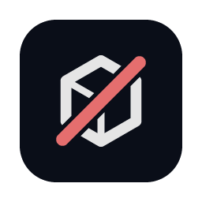

<p align="center">
  
</p>

<h1 align="center">NØDE CAD</h1>

<p align="center">
  <strong>Logiciel de CAO 3D paramétrique, gratuit et open source, avec IA intégrée.</strong><br />
  Esquissez, cotez, construisez des pièces et des assemblages, exportez en STEP — sur Mac,
  sur Windows ou directement dans le navigateur. Un serveur MCP intégré permet à un agent IA
  de modéliser avec vous.
</p>

<p align="center">
  <a href="https://node-os.fr/cad">Site</a> ·
  <a href="https://node-os.fr/cad#telecharger">Télécharger</a> ·
  <a href="https://node-os.fr/cad/app/">Essayer dans le navigateur</a> ·
  <a href="https://github.com/matthias037/node-cad/issues">Signaler un problème</a>
</p>

<p align="center">
  <a href="LICENSE-APACHE"></a>
  
  
</p>

## Télécharger

Les installateurs et la version web sont sur **[node-os.fr/cad](https://node-os.fr/cad)**. Un
compte NØDE gratuit est demandé pour télécharger ; le logiciel lui-même fonctionne hors ligne et
ne se connecte à aucun service.

Les installateurs ne sont pas encore signés : à la première ouverture, macOS demande de passer
par *Réglages Système > Confidentialité et sécurité > Ouvrir quand même*, et Windows par
*Informations complémentaires > Exécuter quand même*.

## Ce que fait NØDE CAD

Jeune, mais déjà utilisable pour des pièces simples.

- **Esquisses et contraintes** : lignes, arcs, splines, texte, cotes pilotées par des paramètres.
- **Fonctions** : extrusion, révolution, balayage, lissage, congé, chanfrein, coque, dépouille,
  perçages, filetages, répétitions, symétrie, dans un historique paramétrique modifiable.
- **Paramètres et configurations** avec des expressions en unités.
- **Assemblages** avec liaisons, études de mouvement, interférences et propriétés de masse.
- **Tôlerie** (bords, ourlets, dépliés) et fonctions pour boîtiers plastiques.
- **Fichiers** : STEP, IGES, 3MF, STL, OBJ et glTF en entrée et en sortie selon les cas.
- **Application de bureau, application web, ligne de commande et serveur MCP**, qui exécutent
  tous les mêmes commandes.

**En préparation :** la FAO (contournage, poche, G-code avec post-processeurs) et des outils IA
avancés proposés en option sur node-os.fr, comme la création d'une pièce à partir d'un plan.

## NØDE IA, l'assistant intégré (en option)

Le logiciel est gratuit ; son assistant intégré, **NØDE IA**, est proposé par abonnement
(**29 € HT par mois**, sans engagement, ou essai gratuit sur demande) sur
[node-os.fr/cad](https://node-os.fr/cad#ia). Dans *Préférences > IA*, connectez-vous avec votre
adresse et le code reçu par e-mail : pas de mot de passe, pas de clé à coller.

NØDE IA répond en français, pour l'atelier, et lit ce que vous lui joignez :

- **plans PDF, Word et PowerPoint**, scannés ou non : le texte des pages, puis les dessins qu'elles
  contiennent ;
- **photos et images** : un plan, une pièce, une plaque de machine ;
- **Excel et LibreOffice** (`.xlsx`, `.xlsm`, `.xls`, `.ods`) : chaque feuille en tableau ;
- **programmes CN** (`.nc`, `.ngc`, `.gcode`, `.tap`, `.h`, `.mpf`, `.iso`…), avec la commande
  numérique probable (Heidenhain, Sinumerik, ISO type Fanuc, LinuxCNC, GRBL) ;
- **STEP, IGES, STL, 3MF, Rhino, FreeCAD** : importés dans la conception, que l'assistant mesure.

Il modifie la pièce avec les mêmes commandes que vos clics. Il fonctionne dans l'application de
bureau ; la version web ne le propose pas.

Vous compilez NØDE CAD vous-même ? `cargo build --release -p solidcraft --features agents-libres`
garde l'ancien fonctionnement : vos agents installés (Claude Code, Codex…) et vos propres points
d'accès (Ollama, LM Studio, une clé d'API).

## IA et agents (MCP)

`node-cad-cli mcp` est un serveur [Model Context Protocol](https://modelcontextprotocol.io).
Sans interface, il ouvre sa propre session de conception ; avec `--connect`, il pilote
l'application ouverte et vous voyez l'agent modéliser.

```sh
claude mcp add node-cad -- node-cad-cli mcp
```

Outils, règles d'accès et exemple de session : [docs/mcp.md](docs/mcp.md).

## Compiler depuis les sources

```sh
cargo run --release --bin node-cad -- --sample         # l'application avec une pièce d'exemple
cargo run --release --bin node-cad-cli -- commands    # la liste des commandes
cargo run --release --bin node-cad-cli -- run examples/bracket.json --out bracket.step
```

Navigateur, compilation Windows et autres commandes : [docs/building.md](docs/building.md).

## Contribuer

Les contributions sont les bienvenues : ouvrez une
[issue](https://github.com/matthias037/node-cad/issues) ou une pull request. Les règles de
licence (aucun code GPL/LGPL/AGPL) et de qualité sont dans [CONTRIBUTING.md](CONTRIBUTING.md)
et [AGENTS.md](AGENTS.md) ; `cargo deny check licenses` refuse toute dépendance copyleft.

## Licence et marque

Le code de NØDE CAD est distribué sous la **[licence Apache 2.0](LICENSE-APACHE)**.

Crédits : les auteurs du code d'origine et les composants tiers sont cités dans [NOTICE](NOTICE)
et [THIRD-PARTY-LICENSES.txt](THIRD-PARTY-LICENSES.txt).

**Les noms NØDE, NØDE CAD et NØDE OS ainsi que le logo sont des marques de NØDE OS et ne sont pas
couverts par la licence Apache.** Vous pouvez reprendre le code, mais une version modifiée
distribuée doit porter un autre nom et un autre logo : voir [TRADEMARKS.md](TRADEMARKS.md).

SolidWorks, Fusion, Rhino et les autres noms de logiciels cités sont des marques de leurs
propriétaires respectifs, nommés uniquement pour décrire la compatibilité.

---

### In English

**NØDE CAD** is a free, open-source parametric 3D CAD application written in Rust, with a
built-in MCP server for AI agents. Code: Apache-2.0; credits in [NOTICE](NOTICE) and
[THIRD-PARTY-LICENSES.txt](THIRD-PARTY-LICENSES.txt). The NØDE names and logo are trademarks and
are not licensed. Downloads and the web app:
[node-os.fr/cad](https://node-os.fr/cad).
